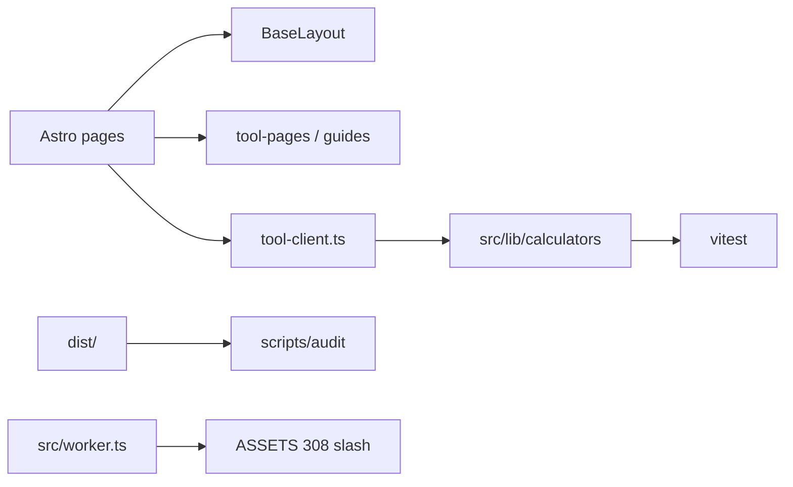

# AGENTS.md — FiberCalc

## Overview

Static Astro + TypeScript site of free **knitting, crochet, sewing, and quilting calculators**. All math is client-side. Brand/domain/ads/analytics live in `src/config/site.ts` (env-overridable).

**Canonical site origin** is a single setting: `PUBLIC_SITE_URL` → `siteConfig.siteUrl` (fallback `src/config/defaults.mjs`). Used for canonicals, sitemap, robots, llms.txt, JSON-LD, OG, IndexNow. Do not hardcode the hostname in pages. Custom domain cutover: `docs/CUSTOM-DOMAIN.md`. SEO do/don’t: `docs/SEO-GUARDRAILS.md`.

## Research before any new page

1. One primary keyword + intent; check `docs/KEYWORD-MAP.md` for cannibalization.
2. Review top SERP formats; plan one gap (table, worked example, cited formula).
3. Follow `docs/PAGE-CHECKLIST.md` and `.cursor/rules/seo-pages.mdc`.
4. Do not invent facts, figures, or citations. Label FiberCalc density factors as site heuristics (`/methodology/#yarn-density`).
5. Guides may use `Label (/tools/slug/)` — `src/lib/guide-links.ts` linkifies for HTML and strips paths from FAQ JSON-LD. Always include a `sources` array.
6. Tools: answer-first with a worked number; calculator above the fold; no duplicate answer/Formula blocks; short Limits section.

## Architecture



- `src/lib/calculators/*` — pure formulas + unit tests  
- `src/scripts/tool-client.ts` — browser handlers  
- `src/data/tool-pages.ts` — per-tool SEO copy + form HTML  
- `src/data/guides/*` — long-form guides (≥~1000 words, FAQ, table)  
- `src/data/tool-guide-map.ts` — tool → guide “Learn more” links  
- `src/pages/tools/[slug].astro` — tool template  
- `src/worker.ts` — 308 trailing-slash redirects (FILE_EXT `{1,16}`)  
- Hub pages under `/knitting-crochet/`, `/sewing/`, `/quilting/`, `/reference/`

## How to add a new tool

1. Implement pure functions in `src/lib/calculators/` + tests in `all.test.ts`.
2. Register metadata in `src/lib/tools.ts` (`TOOLS` + `related` slugs).
3. Add a page object to `src/data/tool-pages.ts` (title short enough that `Title | FiberCalc` ≤60 chars, description 120–160, ≥600 words across answer/sections/faqs, form fields, sources).
4. Add a handler key in `src/scripts/tool-client.ts`.
5. Map related guides in `src/data/tool-guide-map.ts`.
6. Link from the right hub page and `docs/KEYWORD-MAP.md` (unique primary keyword).
7. Optionally add `/embed/[slug]/` (automatic via `TOOL_PAGES`).
8. Run `npm test && npm run build && npm run audit`.

### Tool page template (content)

1. Answer-first paragraph (40–60 words) under H1  
2. Working calculator above the fold  
3. “Learn more” guides block  
4. Formula / method  
5. Worked example  
6. Tips + common mistakes  
7. FAQ  
8. Sources with outbound links  
9. Related tools + embed link  

### Guide template

1. Entry in `src/data/guides/<slug>.ts` + export from `guides/index.ts`  
2. Takeaway + ~1000 words, table, 4–6 FAQs (FAQPage JSON-LD)  
3. `relatedTools` + `relatedGuides`; hub + llms.txt + sitemap via registry  
4. No invented statistics—label rules of thumb  

## Content / SEO / AdSense rules

Follow `docs/SEO-PLAYBOOK.md`, `docs/SEO-GUARDRAILS.md`, `docs/KEYWORD-MAP.md`, `docs/ADSENSE.md`. No thin duplicates. Cite CYC / industry sources. Privacy must mention AdSense/cookies before enabling ads.

**Never** put `import` inside `<script define:vars>` (classic script — breaks GA). Pass IDs via data attributes or a tiny inline stub, then a bundled module script.

**Never** put `PUBLIC_*` in wrangler top-level `vars` (breaks `npx wrangler preview`); keep `"previews": {}`.

## Quality bar

- Mobile-first, 48px targets, `inputmode="decimal"` on numeric fields  
- Lighthouse mobile ≥95 (perf/a11y/BP/SEO)  
- JS gzip per chunk ≤50KB  
- Unit tests for formulas  
- `npm run audit` green (titles, meta, H1, canonical, guide links, guide word count, sitemap, JSON-LD, og:image slash, example.com, IndexNow, site-origin)  

## Commands

| Command | Purpose |
|---|---|
| `npm run dev` | Local dev server |
| `npm run build` | OG images + static build to `dist/` |
| `npm test` | Vitest formula tests |
| `npm run audit` | Build + SEO/AdSense/JS/link/guardrail/page-checklist audits |
| `npm run audit:checklist` | Fast per-page checklist on existing `dist/` |
| `npm run lhci` | Lighthouse CI budgets |

## Definition of done

- [ ] Tool works end-to-end with shareable query-string state  
- [ ] Tests cover new formulas  
- [ ] Unique keyword + ≥600 words (tools) / ≥800 words (guides) + sources  
- [ ] Internal links from hub + related tools + guide map  
- [ ] Audits pass; no new Lighthouse regressions  

## Subagents / skills

See `.cursor/agents/` and `.cursor/skills/` for seo-auditor, content-writer, adsense-reviewer, performance-auditor, link-builder-researcher, fiber-arts-fact-checker roles.

## UI/UX Pro Max

Use this skill for **any change to how the site looks or behaves** (layout, components, CSS, interaction, a11y, responsive, motion).

1. Read [`.cursor/skills/ui-ux-pro-max/SKILL.md`](.cursor/skills/ui-ux-pro-max/SKILL.md).
2. Search the local design database:

```bash
python3 .cursor/skills/ui-ux-pro-max/scripts/search.py "<query>" --domain <domain>
```

Optional flags from `SKILL.md`: `--design-system` (new page / visual direction), `--stack astro` (Astro-specific UI guidance), plus `--domain` values such as `ux`, `typography`, `color`, `style`.

**Priority checks before shipping UI:** contrast ≥4.5:1 · 44px touch targets · visible focus · labels and inline errors · dark mode · no horizontal scroll · reduced motion.

Example (real output, shortened):

```text
$ python3 .cursor/skills/ui-ux-pro-max/scripts/search.py "contrast focus touch targets forms" --domain ux
## UI Pro Max Search Results
**Domain:** ux | **Query:** contrast focus touch targets forms | **Found:** 3 results
### Result 1 — Touch / Touch Spacing (Mobile): Minimum 8px gap between touch targets
### Result 2 — Responsive / Touch Friendly (Web): Increase touch targets on mobile
### Result 3 — Accessibility / Focus Appearance: outline ≥2 CSS px with adequate state contrast
```

