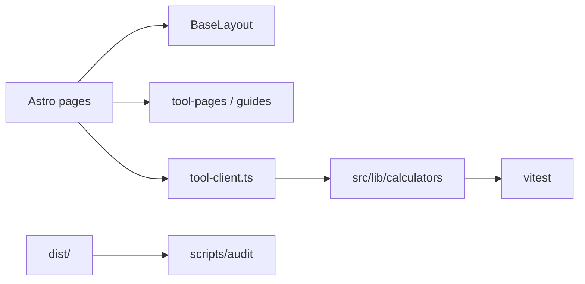

# AGENTS.md — FiberCalc

## Overview

Static Astro + TypeScript site of free **knitting, crochet, sewing, and quilting calculators**. All math is client-side. Brand/domain/ads/analytics live in `src/config/site.ts` (env-overridable).

## Architecture

- `src/lib/calculators/*` — pure formulas + unit tests  
- `src/scripts/tool-client.ts` — browser handlers  
- `src/data/tool-pages.ts` — per-tool SEO copy + form HTML  
- `src/pages/tools/[slug].astro` — tool template  
- Hub pages under `/knitting-crochet/`, `/sewing/`, `/quilting/`, `/reference/`

## How to add a new tool

1. Implement pure functions in `src/lib/calculators/` + tests in `all.test.ts`.
2. Register metadata in `src/lib/tools.ts` (`TOOLS` + `related` slugs).
3. Add a page object to `src/data/tool-pages.ts` (title ≤ ~45 chars before brand suffix, description <155, ≥600 words across answer/sections/faqs, form fields, sources).
4. Add a handler key in `src/scripts/tool-client.ts`.
5. Link from the right hub page and `docs/KEYWORD-MAP.md` (unique primary keyword).
6. Optionally add `/embed/[slug]/` (automatic via `TOOL_PAGES`).
7. Run `npm test && npm run build && npm run audit`.

### Tool page template (content)

1. Answer-first paragraph (40–60 words)  
2. Working calculator above the fold  
3. Formula / method  
4. Worked example  
5. Tips + common mistakes  
6. FAQ  
7. Sources with outbound links  
8. Related tools + embed link  

## Content / SEO / AdSense rules

Follow `docs/SEO-PLAYBOOK.md`, `docs/KEYWORD-MAP.md`, `docs/ADSENSE.md`. No thin duplicates. Cite CYC / industry sources. Privacy must mention AdSense/cookies before enabling ads.

## Quality bar

- Mobile-first, 48px targets, `inputmode="decimal"` on numeric fields  
- Lighthouse mobile ≥95 (perf/a11y/BP/SEO)  
- JS gzip per chunk ≤50KB  
- Unit tests for formulas  
- `npm run audit` green  

## Commands

| Command | Purpose |
|---|---|
| `npm run dev` | Local dev server |
| `npm run build` | Static build to `dist/` |
| `npm test` | Vitest formula tests |
| `npm run audit` | Build + SEO/AdSense/JS/link audits |
| `npm run lhci` | Lighthouse CI budgets |

## Definition of done

- [ ] Tool works end-to-end with shareable query-string state  
- [ ] Tests cover new formulas  
- [ ] Unique keyword + ≥600 words + sources  
- [ ] Internal links from hub + related tools  
- [ ] Audits pass; no new Lighthouse regressions  

## Subagents / skills

See `.cursor/agents/` and `.cursor/skills/` for seo-auditor, content-writer, adsense-reviewer, performance-auditor, link-builder-researcher, fiber-arts-fact-checker roles.
