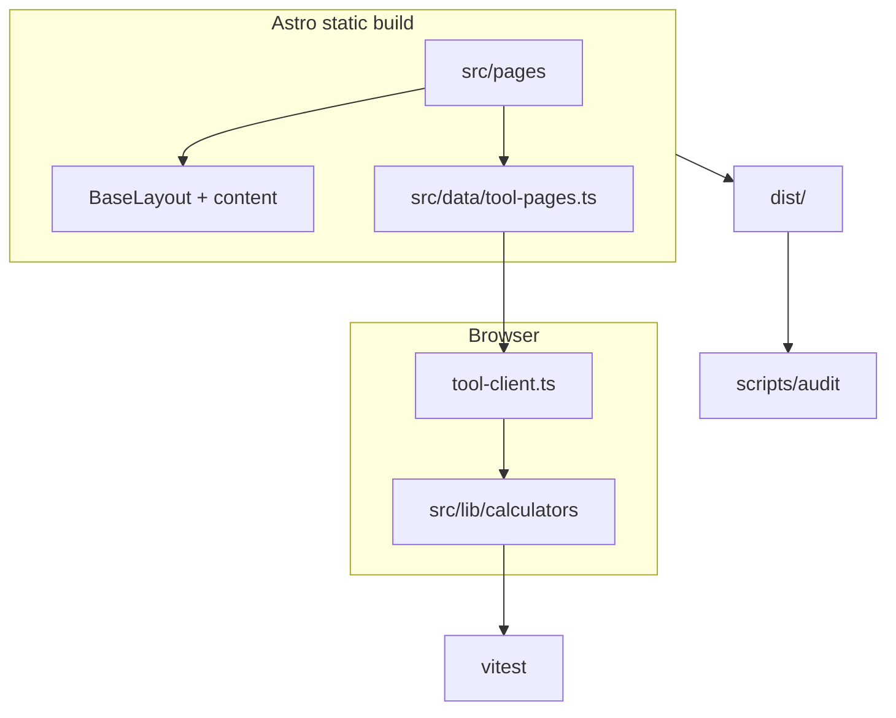

# FiberCalc — fiber arts calculators

Free, client-side **knitting, crochet, sewing, and quilting calculators**: yarn yardage, gauge, cast-on, fabric yardage, quilt backing/binding, HST cutting, cross-stitch Aida sizing, and needle/hook conversion. Built for speed, mobile-first UX, and technical SEO.

## Goals

- Help makers plan yarn, fabric, and quilt cuts with transparent formulas
- Rank for long-tail calculator keywords (see [docs/KEYWORD-MAP.md](docs/KEYWORD-MAP.md))
- Stay AdSense-ready with required policy pages and reserved ad slots
- Keep all tool math in the browser (privacy-friendly)

## Tool list

| Tool | Path |
|---|---|
| Yarn blanket calculator | `/tools/yarn-blanket-calculator/` |
| Yarn sweater calculator | `/tools/yarn-sweater-calculator/` |
| Yarn hat calculator | `/tools/yarn-hat-calculator/` |
| Yarn scarf calculator | `/tools/yarn-scarf-calculator/` |
| Amigurumi yarn calculator | `/tools/yarn-amigurumi-calculator/` |
| Yarn substitution & weight converter | `/tools/yarn-substitution-calculator/` |
| Knitting gauge calculator | `/tools/knitting-gauge-calculator/` |
| Crochet blanket stitch calculator | `/tools/crochet-blanket-calculator/` |
| Increase/decrease evenly | `/tools/increase-decrease-calculator/` |
| Cast-on calculator | `/tools/cast-on-calculator/` |
| Fabric yardage calculator | `/tools/fabric-yardage-calculator/` |
| Quilt size calculator | `/tools/quilt-size-calculator/` |
| Quilt backing calculator | `/tools/quilt-backing-calculator/` |
| Quilt binding calculator | `/tools/quilt-binding-calculator/` |
| HST cutting calculator | `/tools/hst-calculator/` |
| Cross-stitch Aida calculator | `/tools/cross-stitch-fabric-calculator/` |
| Needle & hook converter | `/tools/needle-hook-converter/` |
| Seam allowance & grading | `/tools/seam-allowance-calculator/` |

Hub pages: `/knitting-crochet/`, `/sewing/`, `/quilting/`, `/reference/`. Guides: `/guides/`.

## Architecture



## Folder structure

```
src/
  config/site.ts       # Brand, domain, ads, analytics placeholders
  lib/calculators/     # Pure formulas + all.test.ts
  lib/reference/       # CYC yarn weights, sizes, needles/hooks
  data/tool-pages.ts   # SEO copy + form markup per tool
  scripts/tool-client.ts
  pages/               # Routes, hubs, legal, embeds
docs/                  # DEPLOYMENT, SEO-GUIDE, ADSENSE, KEYWORD-MAP, ideas
scripts/audit/         # SEO, AdSense, JS budget, link check
.cursor/               # Skills, rules, agents for Cursor
```

## Prerequisites

- Node.js 20+
- npm 10+

## Local setup

```bash
npm ci
npm run dev      # http://localhost:4321
npm run build    # output to dist/
npm run preview  # serve dist locally
```

## Scripts

| Script | Description |
|---|---|
| `npm run dev` | Astro dev server |
| `npm run build` | Production static build |
| `npm test` | Vitest unit tests for all formulas |
| `npm run audit` | Build + SEO, AdSense, JS budget, link audits |
| `npm run audit:seo` | SEO audit on `dist/` |
| `npm run audit:adsense` | Policy/thin-page checks |
| `npm run audit:budget` | Per-chunk gzip JS budget (50 KB) |
| `npm run check-links` | Internal link checker |
| `npm run lhci` | Lighthouse CI (mobile budgets in `lighthouserc.cjs`) |
| `npm run indexnow` | Ping IndexNow from `dist/` sitemaps (post-deploy; never fails build) |
| `npm run deploy` | `npx wrangler deploy` (static Worker from `dist/`) |
| `npm run deploy:indexnow` | Deploy then IndexNow ping |

## Configuration

All owner placeholders live in **`src/config/site.ts`** (overridable via `PUBLIC_*` env vars — see `.env.example`):

| Variable | Purpose |
|---|---|
| `PUBLIC_SITE_URL` | Canonical origin (no trailing slash) |
| `PUBLIC_SITE_NAME` | Brand name in nav/schema |
| `PUBLIC_CONTACT_EMAIL` | Contact + footer + JSON-LD (default: `hammadiqbal117@gmail.com`) |
| `PUBLIC_LEGAL_NAME` | Privacy/Terms entity |
| `PUBLIC_ADSENSE_PUBLISHER_ID` | AdSense `pub-…` |
| `PUBLIC_ADSENSE_ENABLED` | `true` to render ad slots |
| `PUBLIC_GA4_MEASUREMENT_ID` | Google Analytics 4 |
| `PUBLIC_GSC_VERIFICATION` | Search Console meta (`google-site-verification`) |
| `PUBLIC_GOOGLE_SITE_VERIFICATION` | Legacy alias for `PUBLIC_GSC_VERIFICATION` |
| `PUBLIC_BING_SITE_VERIFICATION` | Bing Webmaster meta |
| `PUBLIC_INDEXNOW_KEY` | IndexNow key file name |
| `PUBLIC_TWITTER_HANDLE` | Twitter card @handle |

## Adding a tool or article

See **[AGENTS.md](AGENTS.md)** — implement calculator → tests → `TOOLS` registry → `tool-pages.ts` → `tool-client` handler → keyword map.

## Testing & CI

- Formula coverage: `src/lib/calculators/all.test.ts`
- GitHub Actions: `.github/workflows/ci.yml` runs `npm test`, `npm run build`, `npm run audit` on PRs

## Performance budgets

- Mobile Lighthouse: performance, accessibility, best practices, SEO ≥ **95**
- CLS ≤ **0.05**, TBT ≤ **150 ms** (lab), LCP &lt; **2.0 s** target
- Initial JS per chunk ≤ **50 KB** gzip (`scripts/audit/js-budget.mjs`)

## SEO & AI search

- Unique titles/descriptions, JSON-LD, sitemap, robots with AI search bots allowed
- Optional `public/llms.txt`
- Launch checklist: [docs/SEO-GUIDE.md](docs/SEO-GUIDE.md)
- Playbook: [docs/SEO-PLAYBOOK.md](docs/SEO-PLAYBOOK.md)

## AdSense

Checklist and enablement: [docs/ADSENSE.md](docs/ADSENSE.md). Update `public/ads.txt` with your publisher line before going live.

## Deployment

Quick start: [docs/DEPLOYMENT.md](docs/DEPLOYMENT.md) (Cloudflare Pages primary).

## Post-launch SEO

Submit sitemap in Google Search Console and Bing. After deploy, run `npm run indexnow` (or `npx wrangler deploy && node scripts/indexnow.mjs` on Workers Builds). See [docs/DEPLOYMENT.md](docs/DEPLOYMENT.md) §7.3.

## Docs index

| Doc | Description |
|---|---|
| [AGENTS.md](AGENTS.md) | Agent/developer handbook |
| [docs/DEPLOYMENT.md](docs/DEPLOYMENT.md) | Full step-by-step deploy, SEO, AdSense, launch checklist |
| [docs/SEO-GUIDE.md](docs/SEO-GUIDE.md) | Launch & 90-day plan |
| [docs/KEYWORD-MAP.md](docs/KEYWORD-MAP.md) | One keyword per URL |
| [docs/ADSENSE.md](docs/ADSENSE.md) | Monetization readiness |
| [docs/ideas/](docs/ideas/) | Research index + backlog |
| `.cursor/skills/` | Cursor skills for this repo |

## Proof (SEO, performance, AdSense readiness)

Committed, reproducible evidence lives in **[`docs/proof/`](docs/proof/README.md)**. Regenerate after any change that affects build output, audits, or budgets:

```bash
npm run proof
```

This builds the site, serves `dist/`, runs Lighthouse (mobile + desktop), Playwright mobile checks, unit tests, audit scripts, structured-data validation, and sitemap/robots checks. **CI** runs `npm run proof:verify` (artifact checks + tests/audits; no Lighthouse/Playwright on runners).

## Troubleshooting

- **Build fails on import paths**: use `../../` from nested `pages/` folders to `components/` and `config/`.
- **Audit word-count failures**: expand `tool-pages.ts` sections; target ≥600 words per tool page.
- **Lighthouse regressions**: avoid external font CDNs; keep calculator JS in `tool-client.ts` only.

## Roadmap

See [docs/ideas/README.md](docs/ideas/README.md) add-on backlog (weaving sett, sock yarn, batting helper, etc.).

## License

Content and code in this repository are provided for the site owner’s use; specify a license file if you open-source the project publicly.
