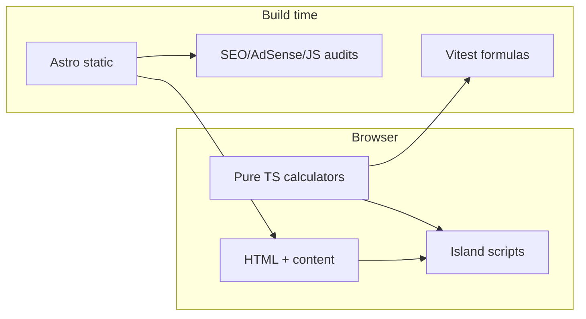

# StitchCalc — Fiber Arts Calculators

Free, privacy-friendly **knitting, crochet, sewing, and quilting** calculators. Static Astro site, client-side math, AdSense-ready, optimized for Google and AI search citations.

**Goals:** rank for long-tail craft calculator queries (research idea #23), pass AdSense review with real explanatory content, ship Lighthouse mobile scores ≥95.

## Tool list

| Tool | Path |
|---|---|
| Yarn blanket calculator | `/tools/yarn-blanket-calculator/` |
| Yarn sweater calculator | `/tools/yarn-sweater-calculator/` |
| Yarn hat calculator | `/tools/yarn-hat-calculator/` |
| Yarn scarf calculator | `/tools/yarn-scarf-calculator/` |
| Amigurumi yarn calculator | `/tools/amigurumi-yarn-calculator/` |
| Yarn substitution / weight converter | `/tools/yarn-substitution-calculator/` |
| Knitting gauge calculator | `/tools/knitting-gauge-calculator/` |
| Crochet blanket size & stitch count | `/tools/crochet-blanket-calculator/` |
| Increase/decrease evenly | `/tools/increase-decrease-calculator/` |
| Cast-on calculator | `/tools/cast-on-calculator/` |
| Fabric yardage | `/tools/fabric-yardage-calculator/` |
| Quilt size | `/tools/quilt-size-calculator/` |
| Quilt backing | `/tools/quilt-backing-calculator/` |
| Quilt binding | `/tools/quilt-binding-calculator/` |
| Half-square triangle cutting | `/tools/half-square-triangle-calculator/` |
| Cross-stitch Aida fabric | `/tools/cross-stitch-fabric-calculator/` |
| Needle/hook size converter | `/tools/needle-hook-size-converter/` |
| Seam allowance & pattern grading | `/tools/seam-allowance-calculator/` |

Hubs: `/knitting/` `/crochet/` `/sewing/` `/quilting/` `/reference/` · Guides: `/guides/`

## Stack & architecture



- **Astro 5** static output + TypeScript  
- Calculator logic in `src/lib/calculators/` (unit tested)  
- Minimal client JS islands per tool  
- Config: `src/config/site.ts` (+ `PUBLIC_*` env)

## Folder structure

```
src/config/          site brand & env placeholders
src/data/            CYC yarn weights, sizes, needles
src/lib/calculators/ pure formulas
src/components/      layout + calculator UIs
src/pages/           routes (tools, hubs, guides, trust)
scripts/audit/       SEO, AdSense, budgets, links
docs/                deployment, SEO, AdSense, research
.cursor/             skills, rules, agents
```

## Prerequisites

- Node.js 20+ (22 recommended)
- npm 10+

## Local setup

```bash
npm install
npm run dev
```

## Scripts

| Script | Purpose |
|---|---|
| `npm run dev` | Dev server |
| `npm run build` | Static build + patch robots sitemap |
| `npm run preview` | Preview `dist/` |
| `npm test` | Formula unit tests |
| `npm run audit` | Build + SEO/AdSense/JS/link audits |
| `npm run check` | Tests + audit |
| `npm run lhci` | Lighthouse CI (mobile budgets) |
| `node scripts/indexnow.mjs` | Ping IndexNow |

## Config / env vars

All owner values live in `src/config/site.ts` or:

| Variable | Meaning |
|---|---|
| `PUBLIC_SITE_URL` | Canonical origin (no trailing slash) |
| `PUBLIC_CONTACT_EMAIL` | Contact / privacy email |
| `PUBLIC_ADSENSE_CLIENT` | `ca-pub-…` |
| `PUBLIC_ADSENSE_ENABLED` | `true` to load ads |
| `PUBLIC_GA4_ID` | GA4 measurement ID |
| `PUBLIC_GSC_VERIFICATION` | Google site verification meta |
| `PUBLIC_BING_VERIFICATION` | Bing verification |
| `PUBLIC_INDEXNOW_KEY` | IndexNow key (match `public/<key>.txt`) |

## Adding a tool / article

Follow [AGENTS.md](./AGENTS.md) and `.cursor/skills/add-new-tool/SKILL.md`.

## Testing & audits

```bash
npm test
npm run audit
```

CI (`.github/workflows/ci.yml`) runs tests, build, audits on PRs. Lighthouse CI uses `lighthouserc.cjs` (perf/a11y/BP/SEO ≥0.95, CLS ≤0.05).

### Performance budgets

- LCP &lt; 2.0s (lab), CLS &lt; 0.05, TBT &lt; 150ms  
- Initial JS per page ≤ 50 KB gzip  
- System font stack; CSS inlined by Astro  
- Reserved ad slot heights  

## SEO / AI-SEO / AdSense

- Per-page title, description, canonical, OG, JSON-LD (`WebApplication`, `BreadcrumbList`, `Organization`)  
- Keyword map: [docs/KEYWORD-MAP.md](./docs/KEYWORD-MAP.md)  
- Playbook: [docs/SEO-PLAYBOOK.md](./docs/SEO-PLAYBOOK.md)  
- AdSense: [docs/ADSENSE.md](./docs/ADSENSE.md)  
- AI crawlers allowed in `robots.txt`; optional `llms.txt`

## Deployment

Quick start: Cloudflare Pages → build `npm run build` → output `dist`. Full steps: [docs/DEPLOYMENT.md](./docs/DEPLOYMENT.md).

Post-launch: [docs/SEO-GUIDE.md](./docs/SEO-GUIDE.md) (GSC, sitemap, Bing/IndexNow, 90-day plan).

## Docs index

| Doc | Contents |
|---|---|
| [AGENTS.md](./AGENTS.md) | Agent overview & how to add tools |
| [docs/DEPLOYMENT.md](./docs/DEPLOYMENT.md) | Hosting |
| [docs/SEO-GUIDE.md](./docs/SEO-GUIDE.md) | Launch SEO |
| [docs/SEO-PLAYBOOK.md](./docs/SEO-PLAYBOOK.md) | Governing SEO research |
| [docs/MARKET-RESEARCH.md](./docs/MARKET-RESEARCH.md) | Niche research |
| [docs/KEYWORD-MAP.md](./docs/KEYWORD-MAP.md) | Primary keywords |
| [docs/ADSENSE.md](./docs/ADSENSE.md) | Monetization |
| [docs/ideas/README.md](./docs/ideas/README.md) | 23-idea index |

## Troubleshooting

- **Wrong sitemap domain:** set `PUBLIC_SITE_URL` and rebuild (`scripts/patch-robots.mjs`).  
- **Ads not showing:** `PUBLIC_ADSENSE_ENABLED` must be `true` and client/slots set.  
- **Audit word-count fail:** expand tool page prose (600–1200 words target).  
- **Hydration/calc blank:** check browser console; scripts are module islands.

## Roadmap

See add-ons in [docs/ideas/README.md](./docs/ideas/README.md) (granny square planner, sock yarn, weaving sett, etc.).

## License

Content and code: use and modify for your own deployment. Replace placeholder brand before public launch. Third-party standards (CYC charts) remain owned by their publishers—cited, not copied as official documents.
